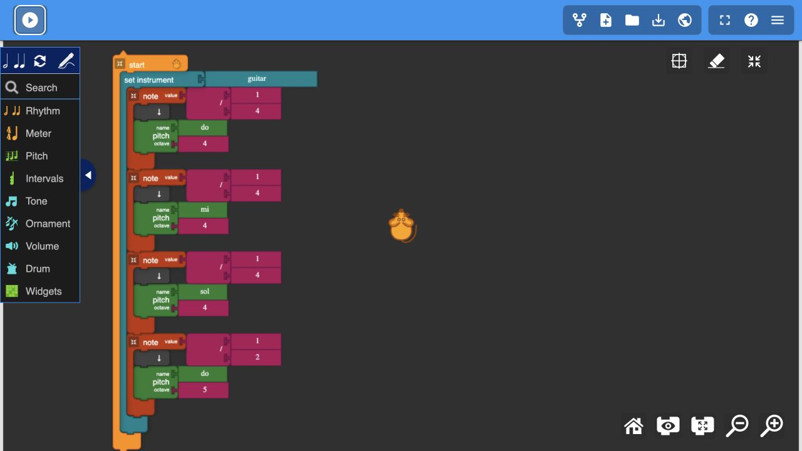

# My First Melody

A four-note C-major guitar melody: Do4, Mi4, Sol4, Do5.
The first three notes are quarter notes; the last is a half note.

[Open the published Music Blocks project](https://musicblocks.sugarlabs.org/index.html?repo=My-First-Melody---titanstride&run=True)

The project was published to Planet and loaded back into the local Music Blocks editor for verification. The public editor was experiencing a startup error at the time of capture.

The `.tb` file can be imported using Music Blocks' Load project from file button.
These files support PR sugarlabs/musicblocks#9466 and are kept on a separate assets branch.
